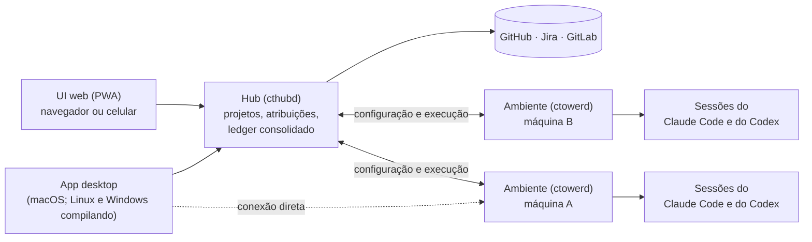

# Control Tower

Uma sala de controle para agentes de código. O Control Tower acompanha e orquestra sessões longas e autônomas do Claude Code e do Codex em vários projetos, épicos e issues, espalhadas por várias máquinas. É para quem deixa agentes trabalhando sozinhos e precisa saber, de um lugar só, o que cada um está fazendo, o que decidiu e onde precisa de você.

## Funcionalidades

- **Sessões em várias máquinas:** cada máquina roda um ambiente (`ctowerd`) com as sessões dos agentes, que sobrevivem a quedas e podem ser retomadas; o app mostra todas juntas.
- **Projetos do GitHub e do Jira:** issues, épicos, sub-issues e PRs (ou MRs do GitLab) espelhados, com o status de cada item andando sozinho conforme o PR abre e é mesclado.
- **Ledger de decisões:** o agente registra cada decisão relevante, que fica ligada à issue e é revisada no PR.
- **Gestor de projetos:** uma sessão que lê o portfólio inteiro e propõe prioridades e status, sem poder mexer no código.
- **No celular:** a UI web (PWA) servida pelo hub, com notificações, para acompanhar e decidir de qualquer lugar.
- **Manutenção pela interface:** permissões dos agentes, logs, atualização do hub e dos ambientes e limpeza de worktrees e branches.

## Como funciona

O **hub** é o plano de controle: guarda os projetos, decide qual ambiente executa cada um e consolida o que todos produzem. Cada **ambiente** roda as sessões dos projetos atribuídos a ele, com hooks, MCP do ledger e um guarda-corpo de comandos, e continua funcionando com a última configuração se o hub cair.

## Começar

1. **Hub e ambiente numa máquina só** (Linux, WSL ou macOS): `scripts/provision/provision.sh --hub --env`. Ele instala o `cthubd` e o `ctowerd` e já os liga. Para separar as máquinas, veja [`docs/hub.md`](docs/hub.md).
2. **Login das ferramentas** no ambiente: `gh auth login && gh auth setup-git` e `claude`.
3. **App:**
   - macOS: `scripts/install-app.sh`;
   - Linux e Windows: compile seguindo [`docs/app.md`](docs/app.md), ou use a UI web do hub ([`docs/acesso-remoto.md`](docs/acesso-remoto.md)).
4. **Ligue o app** ao hub em **Configurações → Hub** e ao ambiente em **Configurações › Conexões** ([`docs/app.md`](docs/app.md)). Depois, cadastre um projeto no hub e atribua-o ao ambiente.

## Documentação

O índice completo está em [`docs/README.md`](docs/README.md). Os principais:

- [`docs/ambiente.md`](docs/ambiente.md): configuração do ambiente, Jira e GitLab, logs, atualização e limpeza;
- [`docs/hub.md`](docs/hub.md): o hub, os projetos, os secrets e o backup;
- [`docs/app.md`](docs/app.md): o app em cada sistema;
- [`docs/acesso-remoto.md`](docs/acesso-remoto.md): a UI web no celular.

## Status

Versão 1.x, com o hub, os ambientes, o app de macOS e a UI web completos; a versão mais recente e as mudanças estão nas [releases](https://github.com/deep-ion-ai/ctower-agents/releases) e no [CHANGELOG.md](CHANGELOG.md). O app desktop é distribuído só para macOS (Apple Silicon); no Linux e no Windows ele é compilado por quem usa, sem suporte oficial. O desenho está em `docs/superpowers/specs/`, e os planos e o roadmap em `docs/superpowers/plans/`.

## Contribuir, licença e segurança

- Contribuições são bem-vindas: veja [CONTRIBUTING.md](CONTRIBUTING.md).
- Código aberto sob a licença [Apache-2.0](LICENSE).
- Vulnerabilidades: siga o [SECURITY.md](SECURITY.md), sem abrir issue pública.
